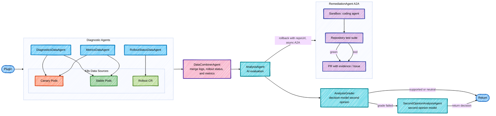

# Software Analysis and Remediation AI Agent

[](https://github.com/kdubois/kubernetes-aiops-agent/actions/workflows/build.yml)

An autonomous AI agent for Kubernetes software delivery debugging and remediation, powered by Quarkus LangChain4j. It works with any OpenAI-compatible chat endpoint: OpenAI, Gemini's compatible endpoint, vLLM, LiteLLM, or an internal gateway.

## Overview

The Kubernetes Agent is an intelligent system that:

- **Debugs** Kubernetes pods automatically
- **Analyzes** logs, metrics, events, and rollout status
- **Aggregates** metrics across every stable and canary pod — latency quantiles, window latency, and heap take the worst pod, so a regression on any single pod is visible even when a canary scale-up adds healthy pods to the average
- **Identifies** root causes of issues
- **Delegates** fixes to the sandboxed [remediation-agent](https://github.com/kdubois/remediation-agent) service, which creates GitHub pull requests or issues
- **Integrates** with Argo Rollouts for canary analysis

## Testing

The agent can analyze and diagnose production issues. The [demo application](https://github.com/kdubois/argo-rollouts-aiops-dashboard) has a load generator and images for four scenarios, including a NullPointerException, a memory leak, and a metrics-only latency drift.

See the [demo script](https://github.com/kdubois/argo-rollouts-aiops-dashboard/blob/main/DEMO_SCRIPT.md) for detailed scenarios:
- **Happy Path**: Successful deployment with AI analysis
- **NullPointerException Bug**: Bug detection with automatic rollback and PR creation
- **Memory Leak**: Performance issue detection with automatic rollback
- **Latency Drift**: Metrics-only regression that passes the early analysis and fails the later one

### Analysis evaluation

The labelled evaluation set in [`src/test/resources/analysis-eval.json`](src/test/resources/analysis-eval.json) measures how often the analysis agrees with the expected decision for known scenarios: the four demo outcomes plus edge cases (bug in stable only, same errors in both, early canary with thin metrics, crash-looping canary). It calls the configured chat model once per case and writes a report to `target/analysis-eval-report.md`:

```bash
ANALYSIS_API_KEY=... ANALYSIS_BASE_URL=... ANALYSIS_MODEL=... \
  ./mvnw test -Dtest=AnalysisEvalTest -Danalysis.eval=true
```

The normal suite never runs the evaluation because it calls the live model; `AnalysisEvalSetTest` (always on) only validates the evaluation set's structure. Run the evaluation before and after changing the `AnalysisAgent` prompt or model to see whether agreement moved.

### Quick Test

```bash
# Check the scenario endpoints of a locally reachable demo app
git clone https://github.com/kdubois/argo-rollouts-aiops-dashboard
cd argo-rollouts-aiops-dashboard
kubectl port-forward -n quarkus-demo svc/quarkus-demo-stable 8080:8080 &
./test-scenarios.sh
```

## Features

### Kubernetes Debugging Tools

- **Pod Debugging**: Analyze pod status, conditions, and container states
- **Events**: Retrieve and correlate cluster events
- **Logs**: Fetch and analyze container logs (including previous crashes)
- **Metrics**: Check resource usage and limits
- **Resources**: Inspect related deployments, services, and configmaps

### Remediation Capabilities

After a rollback decision with a repository URL configured, the agent delegates the fix to the
[remediation-agent](https://github.com/kdubois/remediation-agent) service over A2A. Remediation is triggered after the
decision event is published, on the final (post-escalation) result, and hands off to a
background A2A call, so the analysis response returns to Argo Rollouts immediately.

The remote remediation agent:

- **Swappable coding agent**: runs opencode (or pi, Bob) in an isolated sandbox pod: restricted Pod Security
  Standard, no service-account token, read-only root filesystem, egress limited to GitHub, Maven Central and the LLM endpoint
- **Verified fixes**: the repository's own test suite runs inside the sandbox after the coding agent finishes;
  a branch is pushed only when the suite is green
- **Evidence-bearing PRs**: pull requests carry the test results, files changed, model, sandbox name and duration
- **Issues for operational problems**: OOM, memory leaks and other operational signals open a GitHub issue instead

The sandboxed flow is defined in the [remediation-agent repository](https://github.com/kdubois/remediation-agent); this
service only composes the request from the analysis result and reports the outcome through the activity events.
When the remediation agent is not configured, the rollback decision stands on its own.

**Example**: when the analysis finds a NullPointerException in the canary logs, the delegated remediation run
clones the application repository, locates the source file in the stack trace, makes a surgical change, and
lets the test suite decide whether the fix ships. The PR body carries the verification evidence.

### REST API

- **REST API**: Expose analysis capabilities via HTTP
- **Integration**: Works with `rollouts-plugin-metric-ai` for canary analysis

### Uncertainty pause gate

When the caller sends `pauseOnUncertainty: true` in the request context, the agent pauses the rollout instead of letting a low-confidence promote decision proceed: if the analysis promotes with confidence below `uncertaintyThreshold` (default 50), the Rollout's `spec.paused` is patched and a human decides with `kubectl argo rollouts unpause` or the promote endpoint below. The measurement itself stays successful — the pause, not an abort, is what holds the rollout. A rollback decision never pauses, since the abort already stops the rollout. The paused rollout name is returned in the response's `pausedRollout` field and published as a `PAUSE` activity event, and the gate publishes a `PAUSE_GATE` event with the full causal chain: self-reported confidence, grader probability, effective confidence, and threshold (a negative grader probability means no second opinion was available).

The rollout named in the request context (`rolloutName`, which the plugin sends) is the one paused; without a name, the first rollout in the namespace is used. An already-paused rollout is not re-patched and does not re-publish an event, but a rollout that a human has unpaused is paused again by a later analysis that is still below the threshold — each measurement applies the gate policy. A pause that fails (for example, missing RBAC) is surfaced as a `PAUSE_FAILED` activity event.

Pausing requires patch permission on rollouts in the target namespace, granted by a namespaced Role (shown under Deployment below); the agent is read-only everywhere else.

### Manual rollout control

Two endpoints serve the human decision on a gate-held rollout, both defaulting to the `quarkus-demo` rollout in the `quarkus-demo` namespace (the same defaults as `GET /rollout/summary`):

- `POST /rollout/promote?namespace=...&name=...` — resumes the rollout by patching `spec.paused` to `false`, the exact reverse of the gate's pause patch. Returns 200 on success, 404 when the rollout does not exist, 500 on error.
- `POST /rollout/abort?namespace=...&name=...` — aborts the rollout to the stable version with the same signal `kubectl argo rollouts abort` sends: a merge patch of `status.abort=true` on the rollout's status subresource, after unpausing so the controller acts on it. The controller scales the canary down and reverts traffic to the stable ReplicaSet. `spec.template` is left alone because Git owns it — the rollout stays in the aborted state until the image is reverted in Git.

Both publish `PROMOTE` / `ABORT` activity events and return a `ControlResult` JSON body (`action`, `namespace`, `rollout`, `error`). Promote needs patch permission on rollouts; abort additionally needs patch on `rollouts/status`. Extend the namespaced pause Role with the `rollouts/status` resource.

### Analysis grader (decision-model second opinion)

The confidence the analysis LLM reports about itself is not always calibrated. After the analysis pass, a decision model grades the conclusion with two yes/no questions over a condensed form of the diagnostic data plus the conclusion: does any evidence contradict the conclusion, and is there enough data to verify it? The answers map onto a three-way verdict on the supported-probability scale the gate consumes — contradicted stays below the 0.30 veto bar (escalation, confidence drop), evidence too thin to verify lands in the neutral band (the self-reported confidence stands; the next measurement is the remedy, not a human), and a verified conclusion reaches 0.5 and above. The grader state carries the decision thresholds the analysis judged against and the action semantics (promote continues to the next measurement, rollback aborts), so "supported" means checkable against the stated policy rather than statistically proven — without that framing, a correct conclusion built on an early-canary sample read as disputed and the gate held healthy rollouts. The sufficiency question names the sample floor (`analysis.sample.min-requests`, default 500 requests in the measurement window), so the grader judges the canary against a fixed threshold instead of comparing it with the stable pods' much larger lifetime total; a repeated canary-only exception counts as enough evidence for a rollback even when its rate is low. A confident analysis the grader contradicts pauses the rollout; a doubted-but-actually-fine analysis promotes as before when the grader agrees.

The grader degrades gracefully: without the decision-model key (`TYPESAFE_API_KEY`), on a call failure, or on a timeout it disables itself and the gate falls back to the self-reported confidence — the grader never fails the measurement. The response contract is unchanged: `confidence` stays the self-reported value; the pause gate and the `DECISION` event reflect the effective confidence, with both values logged next to each other.

Every grade is published as a `QUALITY_CHECK` activity event with the score and the finding — `passed` (≥ 50/100, the evidence backs the conclusion), `neutral` (30–50, the evidence is too thin to decide), or `failed` (below 30/100, the evidence contradicts the conclusion). The evidence itself is gathered as a window: metrics are scraped twice with `analysis.sample.window-seconds` (default 10) between them, and the analysis judges the delta — the requests, errors and latency observed during the measurement, unaffected by pod warmup. The window reports the fleet mean and the worst pod's mean latency; the worst pod is the signal because freshly scaled-up canary pods would otherwise dilute a single slow pod back to baseline. The window extends while the canary sample is below `analysis.sample.min-requests` (default 500 — an error rate over a handful of requests is noise), bounded by `analysis.sample.max-waits`; each extension shows in the feed as a "Gathering more canary evidence" event. The event order tells the story: the `CONFIDENCE_SCORE` event publishes the model's self-reported confidence right after its conclusion, the quality check grades it next, and the `DECISION` event announces the effective confidence with both inputs. When the escalation tier re-analyzes a failed conclusion, the `MODEL_ESCALATION` event names both models and their decisions, e.g. `glm-5-3 said continue (95/100), quality check failed at 29/100 — DeepSeek-V4.1 re-analyzed: continue (85/100)`. The model names come from the configuration (`quarkus.langchain4j.openai.chat-model.model-name` and `analysis.escalation.model`), so the events always name the models actually in use.

The grader is a single decision call with a threshold (grade → combine → gate), shaped like langchain4j-agentic's Confidence Cascade pattern, so a future tiered-model design (cheap analysis first, a second opinion model when uncertain) can adopt the cascade planner directly.

## Architecture



## CI/CD

The project uses GitHub Actions for automated builds and deployments:

- **Automated Builds**: Every push to `main` triggers a build, runs tests, and pushes container images to GitHub Container Registry (GHCR)
- **Test Coverage**: Code coverage reports are automatically uploaded to Codecov
- **Pull Request Validation**: PRs are built and tested automatically without pushing images
- **Container Images**: Available at `ghcr.io/kdubois/kubernetes-agent`
- **Dependency Management**: Dependabot automatically creates PRs for Maven dependencies, GitHub Actions, and Docker base images

Container images are tagged with:
- `latest` for the main branch
- Version tags for releases (e.g., `v1.0.0`)
- SHA-based tags for all builds

## Prerequisites

- Java 25+ and Maven 3.8+ for local development
- A Kubernetes cluster with the Argo Rollouts CRDs installed (`kubectl` access)
- An API key for an OpenAI-compatible endpoint
- Optional: a decision-model key for the grader, a second opinion model for the escalation tier, and a reachable remediation agent

## Local Development

### 1. Set environment variables

```bash
export ANALYSIS_API_KEY="your-api-key"   # Any OpenAI-compatible API key
```

### 2. Run locally

```bash
./mvnw quarkus:dev

# Server starts on port 8080
# Health check: http://localhost:8080/q/health
```

## Deployment to Kubernetes

The agent runs on any Kubernetes cluster with the Argo Rollouts CRDs installed. The reference deployment runs on OpenShift in the `openshift-gitops` namespace next to Argo CD, but nothing in the agent depends on OpenShift.

### 1. Build the image

```bash
./mvnw clean package -Dquarkus.profile=prod
docker build -f src/main/docker/Dockerfile.jvm -t ghcr.io/kdubois/kubernetes-agent:latest .
docker push ghcr.io/kdubois/kubernetes-agent:latest
```

Or build and push with Quarkus:

```bash
./mvnw quarkus:image-push -Dquarkus.container-image.build=true -Dquarkus.profile=prod
```

The prebuilt image is `ghcr.io/kdubois/kubernetes-agent:main`.

### 2. Create the secret

Copy the template and fill in the model endpoint and keys:

```bash
cp deployment/secret.yaml.template deployment/secret.yaml
$EDITOR deployment/secret.yaml
kubectl apply -f deployment/secret.yaml
```

The required key is `analysis_api_key`. `analysis_second_opinion_api_key` enables the escalation tier, and `typesafe_api_key` enables the decision-model grader; both are optional. The secret is mounted by the Deployment, so a key change needs a pod restart.

### 3. Deploy

```bash
kubectl apply -k deployment/
```

The kustomization deploys into the `argo-rollouts` namespace. Change `namespace:` in `deployment/kustomization.yaml` to deploy elsewhere, and update the ServiceAccount namespace in `deployment/rbac.yaml` to match.

If you enable the pause gate, the agent also needs `patch` on `rollouts` in the namespaces it watches. The ClusterRole in `deployment/rbac.yaml` is read-only; add a namespaced Role for each rollout namespace:

```yaml
apiVersion: rbac.authorization.k8s.io/v1
kind: Role
metadata:
  name: kubernetes-agent-pause
  namespace: my-app
rules:
- apiGroups: ["argoproj.io"]
  resources: ["rollouts"]
  verbs: ["get", "patch"]
```

### 4. Verify

```bash
kubectl get pods -n argo-rollouts | grep kubernetes-agent
kubectl logs -f deployment/kubernetes-agent -n argo-rollouts
kubectl port-forward -n argo-rollouts svc/kubernetes-agent 8080:8080
curl http://localhost:8080/q/health
```

### 5. Smoke test

`smoke-test.sh` sends a real analysis request to a running agent and checks the response shape:

```bash
# Exec into the pod (default), in the agent's namespace
./smoke-test.sh

# Hit a locally running agent
./smoke-test.sh local

# Different cluster context or namespaces
CONTEXT=my-context AGENT_NAMESPACE=argo-rollouts NAMESPACE=my-app ./smoke-test.sh
```

### Using the progressive-delivery example

[`progressive-delivery`](https://github.com/kdubois/progressive-delivery) is one way to instantiate the whole stack: Argo CD, Argo Rollouts, this agent, the remediation agent, and a demo application, with the reference OpenShift configuration. The agent does not depend on it; deploy it on its own with the manifests above and point the AnalysisTemplate at its Service.

## Usage

### REST API

The agent exposes a REST API for other systems to use:

**Endpoint**: `POST /analyze`

**Request**:
```json
{
	"userId": "argo-rollouts",
	"prompt": "Analyze canary deployment health",
	"context": {
		"namespace": "quarkus-demo",
		"rolloutName": "quarkus-demo",
		"repoUrl": "https://github.com/example/quarkus-demo",
		"stableSelector": "role=stable",
		"canarySelector": "role=canary"
	}
}
```

**Response**:
```json
{
	"analysis": "Detailed analysis text...",
	"rootCause": "Identified root cause",
	"remediation": "Suggested fixes",
	"promote": false,
	"confidence": 85,
	"pausedRollout": null,
	"error": null
}
```

On failure the endpoint returns HTTP 500 (or 504 on timeout) with `promote: false`,
`confidence: 0`, and a short `error` message.

Manual rollout control (see [Manual rollout control](#manual-rollout-control)):

```bash
POST /rollout/promote?namespace=quarkus-demo&name=quarkus-demo   # resume a gate-held rollout
POST /rollout/abort?namespace=quarkus-demo&name=quarkus-demo     # abort to the stable version
```

Both return a `ControlResult`:

```json
{
	"action": "promote",
	"namespace": "quarkus-demo",
	"rollout": "quarkus-demo",
	"error": null
}
```

## Integration with Argo Rollouts

The plugin sends pod selectors and context to the agent. The agent fetches logs and metrics itself with its Kubernetes tools, so the plugin does not ship logs in the request.

### 1. Configure the AnalysisTemplate

```yaml
apiVersion: argoproj.io/v1alpha1
kind: AnalysisTemplate
metadata:
  name: ai-analysis-agent
spec:
  args:
  - name: namespace
  - name: canary-pod
  - name: stable-pod-label
    value: app=quarkus-demo,role=stable
  - name: canary-pod-label
    value: app=quarkus-demo,role=canary
  metrics:
    - name: ai-analysis
      failureLimit: 0
      count: 2
      interval: 30s
      initialDelay: 5s
      provider:
        plugin:
          argoproj-labs/metric-ai:
            agentUrl: http://kubernetes-agent:8080
            stableLabel: role=stable
            canaryLabel: role=canary
            githubUrl: https://github.com/org/app   # optional, enables remediation
            baseBranch: main
            extraPrompt: "Ignore startup noise."
            pauseOnUncertainty: true
            uncertaintyThreshold: 50
```

`count: 2` gives each rollout two measurements: one early, one after traffic accumulates. A rollback in either aborts the rollout.

### 2. What the plugin does

1. Checks the agent health endpoint.
2. POSTs `/analyze` with `namespace`, `rolloutName`, `stableSelector`, `canarySelector`, the optional `repoUrl`/`baseBranch`, and the pause-gate settings.
3. Maps the agent's `promote` and `confidence` onto the metric result.
4. Reports a failure to Argo Rollouts when the agent decides to roll back.

The decision is synchronous. Remediation runs in the background after a rollback and does not delay the metric.

## Configuration

### Environment Variables

| Variable | Required | Description |
|----------|----------|-------------|
| `ANALYSIS_API_KEY` | Yes | API key for the analysis model (any OpenAI-compatible endpoint) |
| `ANALYSIS_BASE_URL` | No | Base URL for analysis model API (default: "https://api.openai.com/v1") |
| `ANALYSIS_MODEL` | No | Analysis model name (default: "gpt-4o") |
| `ANALYSIS_SECOND_OPINION_API_KEY` | No | API key for the escalation tier; without it escalation is disabled |
| `ANALYSIS_SECOND_OPINION_BASE_URL` | No | Base URL for the escalation tier |
| `ANALYSIS_SECOND_OPINION_MODEL` | No | Model for the escalation tier; empty disables escalation |
| `TYPESAFE_API_KEY` | No | API key for the decision-model grader; without it the grader disables itself and the pause gate uses the self-reported confidence |
| `REMEDIATION_AGENT_URL` | No | URL of the remediation-agent A2A service (defaults to `http://remediation-agent:8080`) |

Sample collection is configurable with `analysis.sample.min-requests` (default 500), `analysis.sample.window-seconds` (default 10), and `analysis.sample.max-waits` (default 3).

### Resource Limits

Recommended settings for production:

```yaml
resources:
	requests:
		memory: "512Mi"
		cpu: "250m"
	limits:
		memory: "2Gi"
		cpu: "1000m"
```

## Troubleshooting

### Agent not starting

```bash
# Check logs
kubectl logs deployment/kubernetes-agent -n argo-rollouts

# Common issues:
# 1. Missing API keys - check secrets
# 2. Invalid service account - check RBAC
# 3. Out of memory - increase limits
# 4. Wrong namespace - check deployment namespace
```

### Health check failing

```bash
# Test endpoint directly
kubectl port-forward -n argo-rollouts svc/kubernetes-agent 8080:8080
curl http://localhost:8080/q/health

# Should return Quarkus health check response
```

### API Key Issues

```bash
# Verify secret exists
kubectl get secret kubernetes-agent -n argo-rollouts

# Check environment variables in pod
kubectl exec -n argo-rollouts deployment/kubernetes-agent -- env | grep -E "ANALYSIS_API_KEY|REMEDIATION_AGENT_URL"
```

### Remediation not running

The agent only delegates; the pull request or issue is opened by the remediation agent. Check the delegation event and the remote service:

```bash
kubectl logs deployment/kubernetes-agent -n argo-rollouts | grep -i "remediation\|a2a"
kubectl get svc remediation-agent -n argo-rollouts
kubectl logs deployment/remediation-agent -n argo-rollouts
```

If the remediation agent is not deployed, leave `remediation.agent.url` unset or `REMEDIATION_AGENT_URL` empty; the rollback still stands.

## Security Considerations

1. **RBAC**: read access to pods, logs, events, and Rollouts. The pause gate adds `patch` on `rollouts` in the target namespace only.
2. **Secrets**: store the model keys in a Kubernetes Secret, not in the image or the ConfigMap.
3. **Network**: use a NetworkPolicy to restrict egress to the model endpoint and the Kubernetes API.
4. **Remediation**: the agent holds no GitHub token. The remediation agent does, scoped to one repository.
5. **Review**: always review a remediation PR before merging.

## Development

### Project Structure

```
kubernetes-agent/
├── src/main/java/dev/kevindubois/rollout/agent/
│   ├── a2a/                          # A2A protocol (agent card, JSON-RPC executor)
│   │   └── A2AAgentExecutor.java
│   ├── analysis/                     # Analysis pipeline
│   │   ├── AnalysisOrchestratorAgent.java # Main workflow (@SequenceAgent)
│   │   ├── AnalysisService.java      # Shared analysis entry point (REST + A2A)
│   │   ├── AnalysisDataAgent.java    # Parallel data gathering (@ParallelAgent)
│   │   ├── DiagnosticsDataAgent.java # Pod diagnostics and logs gathering
│   │   ├── RolloutStatusDataAgent.java # Rollout phase, step, and traffic weights
│   │   ├── MetricsDataAgent.java     # Metrics gathering
│   │   ├── DataCombinerAgent.java    # Combine data sources
│   │   ├── AnalysisAgent.java        # AI analysis and promote/rollback decision
│   │   ├── AnalysisGrader.java       # Decision-model second opinion and verdict
│   │   ├── AnalysisEscalation.java   # Second-opinion re-analysis on a failed grade
│   │   ├── SecondOpinionAnalysisAgent.java
│   │   └── PauseGate.java            # Uncertainty pause policy
│   ├── api/                          # REST API
│   │   ├── KubernetesAgentResource.java # Analysis endpoint (POST /analyze)
│   │   ├── RolloutControlResource.java  # Promote/abort endpoints
│   │   └── RolloutSummaryResource.java # Rollout summary REST endpoint
│   ├── k8s/                          # Kubernetes tools and Rollout CR models
│   │   └── K8sTools.java             # K8s data gathering tools
│   ├── observability/                # Activity events for the demo UI
│   ├── remediation/                  # A2A delegation to the remediation agent
│   └── utils/                        # Utilities
├── deployment/                       # Kubernetes manifests
│   ├── deployment.yaml
│   ├── rbac.yaml
│   ├── service.yaml
│   └── secret.yaml.template
├── smoke-test.sh                     # Live cluster request and response check
├── pom.xml                           # Maven config
└── src/main/docker/                  # Dockerfiles
    ├── Dockerfile.jvm
    ├── Dockerfile.native
    └── Dockerfile.native-micro
```

### Running Tests

```bash
# Unit tests (no external calls)
./mvnw test

# Unit tests plus coverage report
./mvnw verify

# Live analysis evaluation against the configured model
ANALYSIS_API_KEY=... ANALYSIS_BASE_URL=... ANALYSIS_MODEL=... \
  ./mvnw test -Dtest=AnalysisEvalTest -Danalysis.eval=true
```

The live grader and escalation evaluation is opt-in as well:

```bash
ANALYSIS_API_KEY=... TYPESAFE_API_KEY=... ANALYSIS_SECOND_OPINION_MODEL=... \
  ./mvnw test -Dtest=GraderEvalTest -Dgrader.eval=true
```

`smoke-test.sh` covers the end-to-end path against a running agent.

See [src/test/README.md](src/test/README.md) for detailed testing documentation.

### Building Multi-arch Images

```bash
docker buildx build --platform linux/amd64,linux/arm64 \
	-t ghcr.io/kdubois/kubernetes-agent:latest \
	--push .
```

## Roadmap

- [ ] Multi-cluster support
- [ ] Historical analysis (learn from past incidents)
- [ ] Cost optimization recommendations
- [ ] Security vulnerability detection
- [ ] Self-healing capabilities
- [ ] Slack/PagerDuty notifications
- [ ] Advanced code analysis before fixes

## Contributing

Contributions are welcome! Please:
1. Fork the repository
2. Create a feature branch
3. Make your changes
4. Add tests
5. Submit a pull request

## License

This project is licensed under the Apache License 2.0 - see the [LICENSE](LICENSE) file for details.

## Additional Documentation

- **[AGENTS.md](AGENTS.md)**: development guide and project conventions
- **[src/test/README.md](src/test/README.md)**: testing documentation and strategies
- **[deployment/](deployment/)**: standalone Kubernetes manifests

## Model Support

The agent supports any OpenAI-compatible endpoint. Configure via environment variables:

### OpenAI
```bash
export ANALYSIS_API_KEY="sk-..."
export ANALYSIS_MODEL="gpt-4o"  # Optional, this is the default
./mvnw quarkus:dev
```

### Google Gemini (via OpenAI-compatible endpoint)
```bash
export ANALYSIS_API_KEY="AIza..."
export ANALYSIS_BASE_URL="https://generativelanguage.googleapis.com/v1beta/openai/"
export ANALYSIS_MODEL="gemini-3.5-flash"
./mvnw quarkus:dev
```

### vLLM / LiteLLM (OpenAI-compatible)
```bash
export ANALYSIS_API_KEY="dummy"
export ANALYSIS_BASE_URL="http://vllm-service:8000/v1"
export ANALYSIS_MODEL="gemma-2-9b-it"
./mvnw quarkus:dev
```
## Support

For issues or questions:
- **GitHub Issues**: [Create an issue](https://github.com/kdubois/kubernetes-aiops-agent/issues)
- **Documentation**: see [AGENTS.md](AGENTS.md) for the development guide


